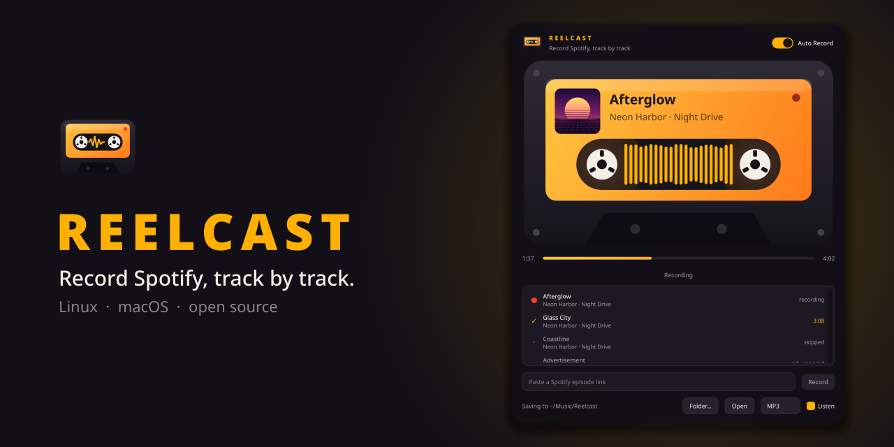
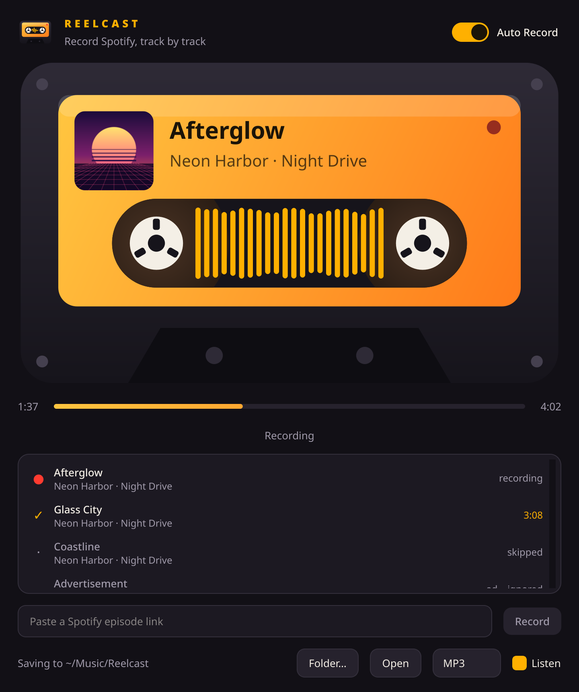
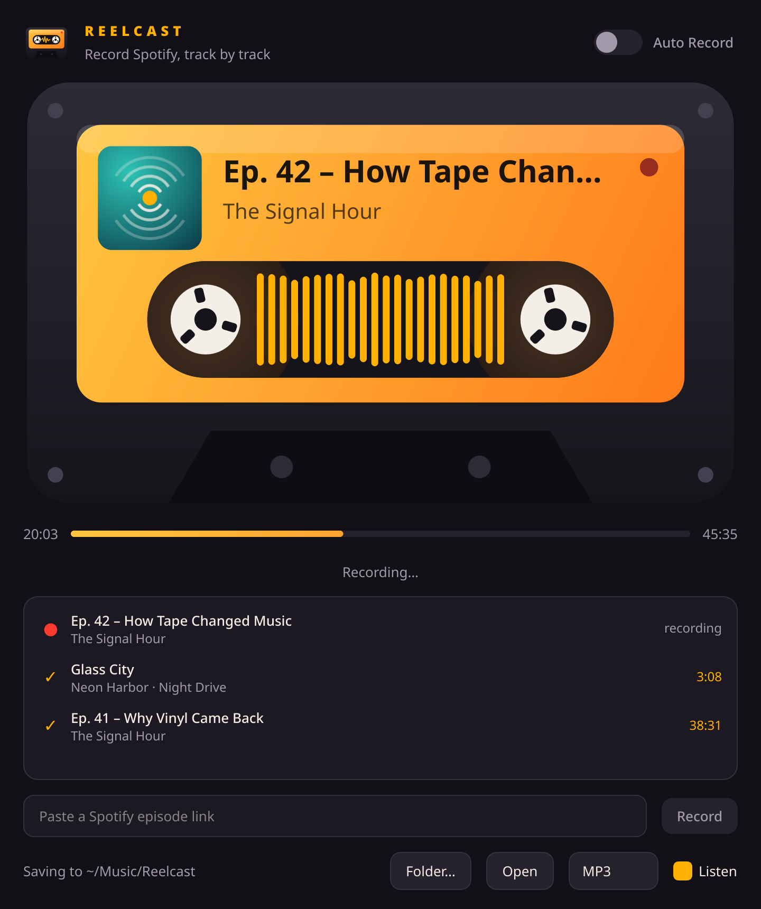
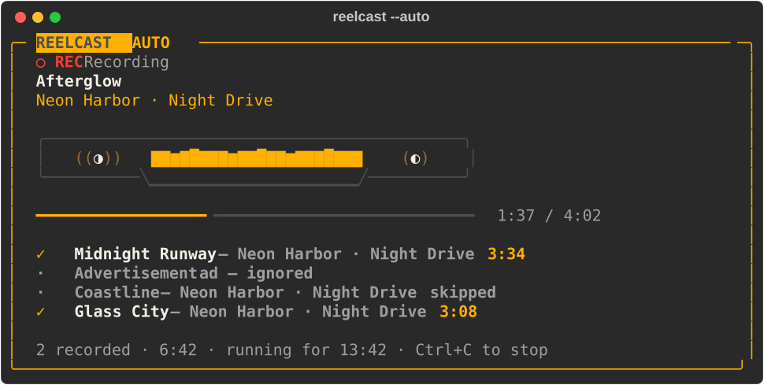
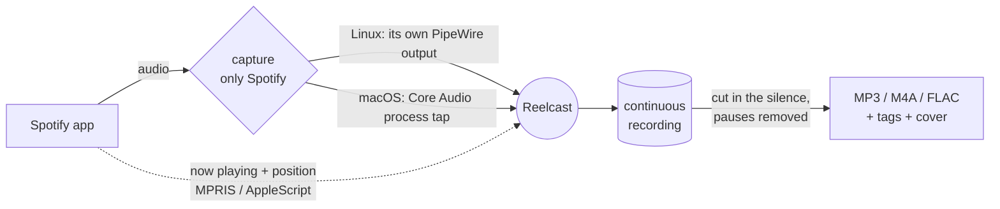

<p align="center">
  
</p>

<p align="center">
  <a href="https://github.com/DevEmperor/reelcast/releases/latest"></a>
  
  
  <a href="LICENSE"></a>
</p>

<p align="center">
  <b>A cassette recorder for Spotify.</b><br>
  Play music – every track lands in its own tagged file. Paste a podcast link – the episode is saved in one go.
</p>

<p align="center">
  <a href="https://github.com/DevEmperor/reelcast/releases/latest"><b>Download</b></a> ·
  <a href="#install">Install</a> ·
  <a href="#how-it-works">How it works</a> ·
  <a href="#faq">FAQ</a>
</p>

---

## Highlights

- **Auto Record** – switch it on and use Spotify as usual. Each complete track becomes its own file.
  Skipped tracks, ads and anything you jumped around in are left out automatically.
- **Clean cuts** – cuts land in the silence between tracks; pauses and buffering are removed.
- **Podcasts in one go** – paste an episode link and Reelcast plays it, records it and tidies up.
- **Tagged and sorted** – title, artist, album, track number, release date and cover art,
  filed under `Music/<artist>/<album>/` and `Podcasts/<show>/`. MP3, M4A or FLAC.
- **Only Spotify** – Reelcast records Spotify's own audio stream, not your speakers. Other apps,
  notification sounds or your microphone never end up in a recording.
- **Window or terminal** – a Qt app with a living cassette, and a full terminal interface.
- **No tricks** – nothing is decrypted, no account data, no API keys. Reelcast records what
  Spotify plays anyway.

## Screenshots

<table>
  <tr>
    <td align="center"><br><sub><b>Auto Record</b> – one file per track</sub></td>
    <td align="center"><br><sub><b>Single episode</b> – paste a link, press Record</sub></td>
  </tr>
</table>

<p align="center">
  <br>
  <sub>The same in the terminal: <code>reelcast --auto</code></sub>
</p>

<sub>Artists, titles and covers in the screenshots are made up.</sub>

## Install

Download the file for your system from the [latest release](https://github.com/DevEmperor/reelcast/releases/latest).

### macOS 14.2 (Sonoma) or newer

1. Open **`Reelcast-1.0.0-macOS.dmg`** and drag Reelcast onto Applications.
2. The first time, right-click Reelcast → **Open** → **Open**. Reelcast isn't notarized by
   Apple, so macOS asks once. If it refuses: System Settings → Privacy & Security →
   **Open Anyway**.
3. On the first recording macOS asks twice – allow both:
   *control Spotify* and *record system audio*.

Everything is included (Python, Qt, FFmpeg). On Apple silicon Macs the app runs through Rosetta 2.

### Arch Linux / Manjaro

```bash
sudo pacman -U reelcast-1.0.0-1-any.pkg.tar.zst
```

### Other Linux distributions

```bash
tar xf reelcast-1.0.0-linux.tar.gz
cd reelcast-1.0.0 && ./install.sh        # ./install.sh --remove undoes it
```

Needs PipeWire (`pactl`, `pw-record`, `pw-metadata`), FFmpeg with libmp3lame, Python 3.11+
with PySide6, NumPy, Rich and PyGObject, and Spotify as a Flatpak or native package.
`reelcast --check` tells you if anything is missing.

## Usage

| | |
|---|---|
| `reelcast --gui` | the app (also in your application menu) |
| `reelcast --auto` | Auto Record in the terminal – Ctrl+C stops |
| `reelcast 'https://open.spotify.com/episode/…'` | record one or more episodes |
| `reelcast -l links.txt` | record every episode link in a file |
| `reelcast --check` | check PipeWire/Core Audio, FFmpeg and Spotify's settings |

Useful options: `-f mp3|m4a|flac` (and `opus` on Linux), `-q 0-9` (MP3 quality, default 2 ≈ 190 kbit/s),
`-o DIR` (output folder), `--listen` / `--mute` (hear the recording or not).

Recordings go to `~/Music/Reelcast`:

```
~/Music/Reelcast/
├── Music/<artist>/<album>/01 - <title>.mp3
└── Podcasts/<show>/<episode title>.mp3
```

## How it works



1. **Capture only Spotify.** On Linux, Spotify plays into a virtual PipeWire output of its own;
   on macOS a small Swift helper taps Spotify's processes directly (macOS 14.2+). You can listen
   along or record silently – and afterwards everything is back to how it was.
2. **Follow the player.** Ten times a second Reelcast reads what Spotify plays and where it is.
3. **Cut precisely.** Spotify's position is mapped onto the continuous recording, the output
   latency is measured at the track boundaries, and every cut is moved into the digital silence
   between two tracks. Standing positions (pauses, buffering) are cut out again.
4. **Keep only what's complete.** A track is saved only if it played from the start to the end
   without jumps; ads and local files are ignored.
5. **Encode and tag** with FFmpeg, add the cover, file it in the right folder.

## Good to know

- **Podcasts at 1×.** Other speeds are detected and the episode isn't saved.
- **Crossfade/Automix off** in Spotify's settings – otherwise tracks can't be separated cleanly.
  `reelcast --check` shows the setting.
- **Spotify stays at 100 %** while recording; use your system volume instead.
- **Spotify Connect:** only what plays *on this computer* can be recorded.
- **Real time:** Reelcast records what Spotify plays, so a 3-minute song takes 3 minutes.
- **Cut accuracy:** Spotify reports its position to about ±0.2 s, which is why cuts go into the
  silence between tracks. On gapless albums (live albums, DJ mixes) a cut can be up to ~0.2 s off.
  On macOS, a pause in the middle of a track can leave a short gap (≤ 0.5 s) where you paused.

## Tested

Version 1.0.0 passed the end-to-end self-test with the real Spotify app on both systems –
16 of 16 checks each:

| System | Spotify | Result |
|---|---|---|
| Linux (Manjaro, KDE Plasma 6, PipeWire) | 1.2.95 (Flatpak) | ✓ 16/16 |
| macOS 15.8 Sequoia (virtual machine) | 1.3.6 | ✓ 16/16 |

On macOS the complete run was done with `Reelcast.app` installed from the DMG; the two timing
fixes that went into the final build were verified with the same code run from source.

The self-test (`reelcast --selftest DIR`) drives the app like a person would: it plays a full
album track with a pause in the middle, skips one after 20 s, plays another one in full, stops a
fourth after 5 s and records a podcast episode through the link field. Then it checks what was
saved – length, tags, cover art and sound – and writes screenshots, waveforms and `result.json`.
The recorded audio is deleted afterwards.

## FAQ

<details>
<summary><b>Is this legal?</b></summary>

Reelcast records the audio Spotify plays on your computer – like a cassette recorder connected
to a radio. Whether such private copies are allowed depends on the law where you live and on
Spotify's terms of use. Use Reelcast only for your own, private use and respect the rights of
artists and podcasters. This is not legal advice.
</details>

<details>
<summary><b>Can it record faster than real time?</b></summary>

No. Reelcast doesn't download anything – it records what Spotify actually plays, so it takes as
long as the music. In exchange, nothing is decrypted or bypassed.
</details>

<details>
<summary><b>Why does macOS ask for permissions?</b></summary>

Reelcast needs two: to *control Spotify* (to know what's playing and to start episodes) and to
*record system audio* (to tap Spotify's sound). You can change both later in System Settings →
Privacy & Security.
</details>

<details>
<summary><b>What about ads?</b></summary>

Ads are recognised and left out of the recording.
</details>

<details>
<summary><b>Windows?</b></summary>

Not supported – Reelcast relies on PipeWire (Linux) and Core Audio process taps (macOS).
</details>

## Building from source

```bash
git clone https://github.com/DevEmperor/reelcast && cd reelcast
python3 -m reelcast --gui            # run straight from the source (Linux)
packaging/build-linux.sh             # Arch package + tarball → dist/
```

**macOS app:** on macOS 14.2+ with the Command Line Tools, build FFmpeg with
[`macos/build-ffmpeg-mac.sh`](macos/build-ffmpeg-mac.sh), create a Python 3.13 venv in
`~/reelcast-dev/venv` with `PySide6-Essentials numpy rich pyinstaller`, then run
[`macos/build-app.sh`](macos/build-app.sh) → `Reelcast.app` and the DMG.

**Tests:** `tests/run_auto_test.py` checks Auto Record against a fake Spotify player with test
tones (cut accuracy, pauses, ads, skipped tracks – silent). `reelcast --selftest DIR` is the
end-to-end test with the real app. `tests/mac_*_probe.py` measure timing on macOS.
The images in this README come from [`tools/make_readme_images.py`](tools/make_readme_images.py).

## License

Reelcast is [MIT licensed](LICENSE). The macOS app bundles FFmpeg, LAME, Qt and Python under their
own licenses – see [THIRD_PARTY_NOTICES.md](THIRD_PARTY_NOTICES.md).

Spotify is a trademark of Spotify AB. Reelcast is an independent project and is not affiliated
with Spotify.
